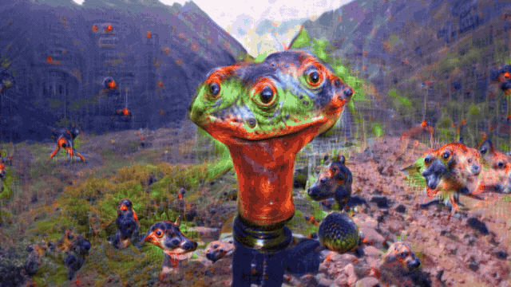

# DeepDream Diffusion

DeepDream Diffusion is a TouchDesigner component that runs a DeepDream gradient
ascent on a live video TOP. The picture is generated by a pretrained network
(InceptionV1, the network of the original 2015 DeepDream, or VGG16), not by a
spatial filter.

Leave this folder where you downloaded it. Drag `DeepDreamDiffusion.tox` from here
into each project. The Setup page tells you the next step.

## Realtime



## Offline


## What you need

- TouchDesigner.
- An NVIDIA driver if you use CUDA. The installer does not install the driver.
  It installs a CUDA build of PyTorch next to this TOX.

## Install once

The download does not include the Python libraries. TouchDesigner already
includes the Python version the component needs. If that cannot be found, the
installer downloads Python for you.

1. Drag `DeepDreamDiffusion.tox` from this folder into a network. Leave the file
   here. TouchDesigner keeps a link to it.
2. Select the component and open the **Setup** page. **Status** says what to
   do next.
3. Pulse **Install Environment**. A window opens. The first run takes several
   minutes, mostly to download PyTorch. You do this once. Yellow NVIDIA
   warnings in that window can be ignored. The install is fine if it ends with
   "Installation complete."
4. When the window says the installation is complete, pulse **Check
   Dependencies**. Status reports the PyTorch version and `CUDA=True`.
5. Connect a Movie File In or Video Device In to the first input and turn
   **Active** on.

Drag the same file into any other project. The environment is already next to
the TOX, so the installer does not run again. `Install.bat` is the same
install if you want to run it before opening TouchDesigner.

**Check Dependencies** runs in `venv_td`, outside TouchDesigner.

The first time a model is used, its ImageNet weights are downloaded. That
needs a network connection and can take a little while. Video passes through
until the model is ready. VGG16 comes from torchvision. InceptionV1 downloads `inception5h.pth` (28 MB) from
[ProGamerGov/pytorch-old-tensorflow-models](https://github.com/ProGamerGov/pytorch-old-tensorflow-models),
a PyTorch copy of Google's `inception5h` model (Apache 2.0). The file is
checked against its SHA-256 before it is loaded.

Do not copy the TOX out of this folder and do not move `venv_td` after it has
been created. A component saved inside the project loses the link, and Status
asks you to drag the file from here again.

## Inside TouchDesigner

```text
Video TOP ──> input 0 ──> DeepDreamDiffusion ──> picture
Mask TOP  ──> input 1  (optional)
                              CHOP out ──> cook and dream stats
```

The video input is resized to **Process Width** on the GPU, dreamed, then
scaled back to the video resolution. The upscaled dream is sharpened by about
one dream pixel, then its difference from a blur of the picture is scaled by
**Effect Contrast** and added to the original video. The photo's fine detail
stays, and the dream can read more clearly without a larger Process Width.
Changing the video resolution or Process Width realigns the picture. If the
dream disappears anyway, pulse **Reset**.

Flat near-black bars that touch the edge of the frame (letterbox or pillarbox)
stay a copy of the source. Dark objects inside the picture are still dreamed.

The second input is an optional mask. White shows the dream, black keeps the
original video, and values in between blend. **Mask Channel** chooses Alpha or
Luminance RGB. The mask is resized to the video. Disconnecting it shows the
dream on the whole frame again.

Changing the source movie, or its resolution, shows the dream on the new
picture again. A size change does not leave the output on the original video.

**Sync Frames** is on by default. Realtime stays as you set it. Each cook
waits until that video frame has been dreamed, so the movie and the dream
advance together. A Movie File In playing on its own clock (Play Mode
Sequential) steps one project frame per dream while the toggle is on, and is
put back when you turn it off. A movie already locked to the timeline, or
driven by Specify Index, is left alone.

Record with Movie File Out **FPS** set to the project rate. At 24 fps in the
project and about 10 fps of dream, Sequential used to skip ahead on the slow
cooks, and the file — stamped at 24 fps — played too fast. With Sync Frames
on, each recorded image is the next project frame, so playback stays at 24 fps.

Turning Sync Frames off puts that movie back on its own clock. The project
keeps its own frame rate, and the latest dream is carried onto the new
frames until the next one is ready.

There is one picture output. **Enable Stats CHOP** exposes a CHOP with
`cook_fps`, `dream_fps`, the current settings, `loading`, `error`,
`dream_frame`, and `sync`. With Sync Frames off, cook fps can stay at the
project rate while dream fps is the GPU rate. With Sync Frames on, both follow
the timeline rate shown by the TouchDesigner player. The cook that flips the
toggle reports 0; the next cooks settle on the real rate.

## How the models work

Each frame is normalized with ImageNet mean and standard deviation, then run
through the chosen network up to one layer. The loss is the mean square of
that layer's activations, measured on the picture and not on the empty border.
The pixels are then stepped along the gradient. The gradient is not blurred:
blurring it turns the sky into contour lines and the subject into rings of
magenta and green. It is divided by its mean absolute value, and its average
color is left in place. Subtracting that average paints the whole frame as a
magenta and green filter, so the step does not do it. **Learning Rate** `0.09`
matches the original DeepDream step of 1.5 on a 0–255 image. That step repeats
for **Iterations** at every **Pyramid** level. Each level starts from the
picture at that size and keeps only the new detail, then carries the detail up
toward Process Width. **Octave Scale** is the size ratio between levels (1.6).

### The shaped step

Before it is taken, the step is reshaped the way feature visualization does it
(Lucid, Olah et al. 2017). This is not a blur: every size of detail stays in the
step, only the balance between them changes.

- **Fourier Decay** divides the spectrum of the step by its frequency raised to
  that power. At `1` a step moves whole shapes as much as pixel grain, the way
  natural images are built, so the same iterations reach larger figures. The
  average color of the step is not raised with the large shapes. Raised, it
  washed the whole frame toward white.
- **Chroma** mixes the color of the step toward the ImageNet color covariance.
  Below `1` a new figure grows in light and shadow and takes the colors already
  in the picture, instead of green and magenta specks.
- **Coarse Boost** adds steps to the small levels, where large figures are
  decided and a step is cheap. At `1` the smallest level runs twice the
  Iterations, and the full size runs Iterations.

`0`, `1`, `0` is the classic step described above. The panel starts at `1`,
`0.35`, `0.5`. Measured on an RTX 4070 at Process Width 700, VGG16 `relu3_3`,
4 iterations, 5 levels, Intensity 1.2, each frame dreamed alone:

| | Classic step | Fourier Decay 1, Chroma 0.35 |
| --- | --- | --- |
| Typical size of a dreamed shape | about 6 px | about 38–47 px |
| Fine color specks in the dream | about 10% of it | under 1% |
| Frame-to-frame change on a slow pan | 0.99 | 0.50 |
| Tint of the whole frame | under 2 of 255 | under 3 of 255 |
| Time per dream | 53.5 ms | 55.7 ms |

Coarse Boost `0.5` adds about 5% to that time, and `1` about 15%.

### InceptionV1

InceptionV1 is the network the first DeepDream pictures were made with:
Google's 2015 `inception5h`, with its local response normalization and pixels
in 0–255 minus 117. It is the default model. It replaced torchvision's
GoogLeNet, which has the same layout but batch normalization and different
weights. Each at its own panel defaults, on the same pictures, torchvision's
GoogLeNet left a cherry blossom a flower. InceptionV1 grows a dog's head out of
it, and figures in the water and sky.

Its first convolution reaches about 5500. The normalization squares that, and
3 × 10⁷ does not fit in float16 (largest value 65504). In float16 the dream
was noise. The normalization runs in float32, and the rest of the network
stays in float16 like the other models. The result matches float32, at
125 ms against 158 ms for a 700 px still with 10 iterations and 4 levels.

At its panel defaults (`mixed4c`, 2 iterations, 4 pyramid levels, Process
Width 512, the shaped step, Dream Memory `0.9`, Temporal Blend `0.35`), a
1280 × 720 video took 26 ms per frame through the GPU process on an RTX 4070:
about 38 fps.

### Dream Memory

Temporal Blend mixes two dreams that were made separately. Their figures do
not line up, so the mix fades them, and the dream is never deeper than what
one frame's iterations draw.

**Dream Memory** keeps the dream itself. Each frame starts from the new video
frame plus the previous dream's detail (the dream minus its video), moved with
the picture by optical flow, and the ascent goes on from there. Figures stay
on what they grew on, follow it when it moves, and deepen over a few frames
until they settle. The share kept per frame sets that level. This is how
optimization-based video stylization stays coherent (Ruder et al. 2016). Only
the detail is carried, so the video itself never lags. Where the flow does not
explain the new frame (a cut, an area that was hidden, the frame edge),
nothing is carried and that area is dreamed fresh.

With **Feedback** above `0` the memory is off: Feedback already sends the whole
previous dream back. **Reset Feedback** clears the memory too.

Measured on an RTX 4070 at Process Width 512, the shaped step, on 100 frames of
sheep walking in a field. Strength is the mean change from the video, out of
255. Flicker is the change of the dream between frames after following the
motion, divided by the strength.

| Model | Before: Temporal Blend `0.35` | Dream Memory `0.9`, 2 iterations |
| --- | --- | --- |
| InceptionV1 `mixed4c`, 4 levels | 3 iterations: 27.9 ms, strength 7.0, flicker 0.37 | 24.2 ms, strength 20.0, flicker 0.12 |
| VGG16 `relu3_3`, 3 levels | 3 iterations: 23.2 ms, strength 9.4, flicker 0.15 | 19.5 ms, strength 25.7, flicker 0.05 |
| VGG16 Experimental `relu4_1`, 2 levels | 4 iterations: 28.2 ms, strength 7.8, flicker 0.22 | 19.7 ms, strength 19.1, flicker 0.07 |

These times are from before the memory moved to the GPU (see **Speed**).

The dream settles in about 25 frames and stays at that level: over 150 frames
it did not keep growing. Temporal Blend `0.35` on top of the memory lowered
InceptionV1's flicker from 0.12 to 0.09 for 0.5 ms, so it stays on as the last
smoothing. One iteration with Dream Memory `0.9` (14 ms on InceptionV1) already
flickered less than three iterations with Temporal Blend. A rocky stream
(flicker 0.53 before, 0.16 after) and a slow camera pan with zoom (0.64, 0.19)
went the same way.

### Speed

The remembered dream stays on the GPU, in the network's normalized space. It
is moved there with the flow, added to the picture there, and kept there for
the next frame. Only the optical flow runs on the CPU, on a 256 px gray copy.
Saturation is one 3 × 3 color matrix in OpenCV instead of NumPy arithmetic.
Measured on InceptionV1 at the panel defaults, inside one process:

| | Before | After |
| --- | --- | --- |
| Process Width 512, whole frame | 30.9 ms | 22.9 ms |
| Moving the memory (flow and warp) | 4.0 ms | 1.9 ms |
| Saturation `1.2` | 4.3 ms | 0.6 ms |
| Process Width 1024, whole frame | 114.8 ms | 58.0 ms |
| Moving the memory | 19.0 ms | 2.6 ms |
| Saturation `1.2` | 25.7 ms | 2.4 ms |

The network itself did not change: 18.5 ms at 512, about 48 ms at 1024.

**Spread Levels** dreams one pyramid level per frame, smallest to largest,
instead of all of them. Each level is then refreshed once every few frames, so
the memory keeps its share once per round, not once per frame. Decaying every
frame made each level pulse. On InceptionV1 at 512 px with 4 levels, the dream
alone:

| | Time per frame (95th percentile) | Strength | Flicker |
| --- | --- | --- | --- |
| Every level, 2 iterations (default) | 20.1 ms (20.6) | 20.3 | 0.12 |
| Every level, 1 iteration | 10.2 ms (10.7) | 11.2 | 0.19 |
| Spread Levels, 2 iterations | 6.8 ms (8.9) | 12.2 | 0.19 |

Spread Levels with 2 iterations matches every level at 1 iteration for two
thirds of the time. It is the fastest way to a full dream. At equal time with
more iterations it flickered more than every level together (0.29 against
0.19 at about 11 ms), and its frames take uneven time, so it is off by
default. Through the GPU process, with a 1280 × 720 video at 512 px, it ran at
13 ms per frame.

The network stops at the layer you select. Deeper layers are not computed.

The dream itself runs in a separate Python process (`venv_td`). That process
owns PyTorch and replays the ascent as a CUDA graph. TouchDesigner only copies
frames. Capturing those graphs inside TouchDesigner takes the application
down, so they stay in the worker.

Changing **Model** loads a default layer, iterations, and pyramid. Those
defaults are a starting point. Models already used in the session stay loaded
in the GPU process.

| Model | What choosing it sets | Layers, shallow to deep |
| --- | --- | --- |
| InceptionV1 (original DeepDream) | Layer 4, 2 iterations, 4 pyramid levels | `mixed3a`, `mixed3b`, `mixed4a`, `mixed4b`, `mixed4c`, `mixed4d`, `mixed4e`, `mixed5a` |
| VGG16 | Layer 2, 2 iterations, 3 pyramid levels | `relu1_2`, `relu2_2`, `relu3_3`, `relu4_3` |
| VGG16 Experimental | Layer 1, 2 iterations, 2 pyramid levels | `relu3_3`, `relu4_1`, `relu4_2`, `relu4_3`, `relu5_1`, `relu5_2`, `relu5_3`, `mp5` |

**Layer Index** picks a row from that list. An index past the last layer wraps
around.

## What each model does live

Read from live frames before Dream Memory existed, with the classic step
(Fourier Decay 0, Chroma 1, Coarse Boost 0), Sync Frames on, Feedback at 0, Temporal Blend about
`0.48`, Effect Contrast `1.2`, Saturation `1.2`. Process Width was about
550–700, with 4 iterations and 5 or 6 pyramid levels. On an RTX 5070 Ti
Laptop that cook stayed between about 11 and 19 fps.

| Model | Layer | What you see |
| --- | --- | --- |
| VGG16 | 0 `relu1_2` | A color-edge filter. Magenta and cyan sit on the contours. The face stays a photograph. |
| VGG16 | 1 `relu2_2` | The person stays recognizable. The background turns into painted curves. This is the setting where the scene holds. |
| VGG16 | 2 `relu3_3` | The live dream. The person becomes an animal and the clothes fill with eyes. About 13 fps at width 700. This is the VGG16 default. |
| VGG16 | 3 `relu4_3` | The same direction, stronger. After a few seconds of Temporal Blend the person is gone. About 11 fps. |
| VGG16 Experimental | 1 `relu4_1` | Eyes grow on the face and replace it. About 19 fps at width 570. This is the Experimental default. |
| VGG16 Experimental | 2 `relu4_2` | A field of eyes, with random green and magenta on top of them. |

The stills in a Google image search are a different recipe: Inception v3 and
many small steps. One still of that recipe took about 8 seconds. It does not
fit in a live frame, so it is not in this component. Even that still kept
scattered green and magenta. The live dream that actually draws figures is
VGG16 from layer 2 up, and VGG16 Experimental. The subject disappears.

InceptionV1 is not in the table yet: it has been read on stills, not on live
frames. On stills at its defaults it grows dog heads, eyes, and creatures out
of the picture (see **InceptionV1** above).

On the same GPU, a lighter cook (4 iterations, 2 pyramid levels, Process Width
800) measured about 15 fps at VGG16 `relu3_3`, 13 fps at `relu4_3`, 13 fps at
VGG16 Experimental `relu4_2`, and 12 fps at `mp5`. Seven iterations and 4 pyramid
levels at Experimental `relu4_2` was about 7 fps. Without Dream Memory,
iterations and pyramid levels were the look and could not be reduced to buy
speed.

## How to use it

**Larger, cleaner figures.** Leave Fourier Decay `1` and Chroma `0.35`. Raise
Coarse Boost toward `1` for a few large faces instead of many small ones. Lower
Fourier Decay toward `0.5` for more, smaller figures. Chroma `1` brings the
classic green and magenta back.

**The original DeepDream.** InceptionV1, with the shaped step. Layer 4
`mixed4c` is the default. Layer 3 `mixed4b` grows dog faces, layer 5 `mixed4d`
more creatures and scales, layers 0–1 the classic swirls and patterns.
Dream Memory builds the figures across frames: `0.95` makes them deeper.
Iterations 1 dreams in about 10 ms at Process Width 512 and still flickers
less than three iterations with Temporal Blend did. **Spread Levels** gets the
same look in about 7 ms.

**Keep more of the video.** Dream Memory deepens the dream, so the subject goes
sooner. On the sheep clip, Dream Memory `0.8` with 1 iteration kept the
outlines of the video about as readable as the old three iterations with
Temporal Blend, at half the time. Dream Memory `0` is the old behavior.

**The classic look.** Fourier Decay `0`, Chroma `1`, Coarse Boost `0`. The rest
of this section was written with those values, before Dream Memory.

**Keep the person in the picture.** VGG16, layer 1. Learning Rate `0.06`–`0.09`,
Intensity about `1.2`, Iterations 4, Pyramid 4–6, Process Width 500–700.
Temporal Blend `0.3`–`0.5`. If the face starts to melt, lower Temporal Blend
or pulse **Reset Feedback**.

**Animals, eyes, swirls.** VGG16 layer 2 or 3, or VGG16 Experimental layer 1.
Width 550–700, Iterations 4, Pyramid 5–6, Learning Rate `0.06`–`0.14`,
Intensity about `1.2`. Temporal Blend near `0.5` builds the dream across
frames. At about six seconds a face can be fully an animal. Pulse **Reset
Feedback** to clear it.

With Feedback at `0`, Dream Memory carries only the hallucination and moves it
with the picture. Temporal Blend then mixes finished results, after the
previous one has been moved to follow the picture. Raising Feedback sends the
whole previous dream back into the network without following the picture, and
turns Dream Memory off. The effect runs away faster. A visible tunnel is Zoom `0.01`,
Rotate `1`, Feedback `0.4`, Temporal Blend `0.25`.

**Process Width** decides how many patterns fit, not how sharp one pattern is.
The filters have a fixed size in pixels, so a wider canvas holds more eyes,
not a larger copy of one eye. The output is always the video resolution. Fine
detail from the video is put back on top of the upscaled dream.

**Effect Contrast** scales the dream against the video. `0` is the original
video. `1` is the dream as calculated. `1.2` is a little stronger. It does not
create figures. **Saturation** `1.2` makes the result more vivid, and it also
makes green and magenta specks louder.

**Learning Rate** `0.09` is the original DeepDream step. **Intensity**
multiplies that step. `0.14` with Intensity `1.4` is about twice the original
step. On VGG that pushes the animal.

**Sync Frames** on makes the project wait, so the movie and the dream stay
together. Off keeps the project frame rate and lets the dream trail the video.

For a first cook, before any of the looks above: Process Width 256, one
pyramid level, two iterations, Intensity `1.0`, Learning Rate `0.09`. When
that cooks, move to the setting you want and raise Process Width.

## Offline render

**Offline Render** is off by default. While it is off, its controls are not on
the page. The live dream is the one described above.

Turn it on and Render Width, Steps, Octaves, Octave Scale, Step Size, Temporal, Look,
Output File, and **Render** are added under the toggle. The live dream pauses
and the video passes through, so the GPU is free. Turn it off and those
controls leave the page.

Connect a Movie File In, then pulse **Render**. A terminal window opens and
prints what each setting does, with the values you chose. It then dreams one
preview frame and opens that picture. Type `y` and Enter to write the whole
movie, or Enter alone to stop and keep only the preview. The movie is an MP4
of the Movie File In: every frame, at the movie's own frame rate, so a 10
second input is a 10 second file. If **Output File** is empty, it is written
in a `renders` folder next to this TOX, and the preview is the same name with
`_preview.png`. When ffmpeg is available, the original audio is copied into
that MP4.

This render uses Inception v3 and the published DeepDream still recipe. It
does not use the live model. Each frame takes about a minute at the default
settings, so a clip takes one minute times its frame count. The window prints
how long is left. Raise Steps toward 50 or 100 and the figures cover the
picture. A mask on the second input is kept.

| Control | What it does |
| --- | --- |
| Offline Render | Off is live, and these controls are absent. On adds them and pauses the live dream. |
| Render Width | Width Inception sees. The height follows the video. Slider 256 to 2048. Default 960. Higher keeps more detail and takes longer. |
| Steps | Ascent steps on every octave. Slider 8 to 200. Default 20 keeps the photo and grows figures in it. 50 to 100 covers the photo. |
| Octaves | How many sizes are dreamed, from small shapes up to Render Width. Slider 2 to 8. Default 4. More octaves add larger structures. |
| Octave Scale | How much larger each octave is than the one before it. Slider 1.15 to 1.6. Default 1.3, the published still recipe. Higher makes the figures larger. |
| Step Size | How far each step moves after the gradient is normalized. Slider 0.004 to 0.03. Default 0.01. Higher is stronger and can speckle. |
| Temporal | How much of the previous dream is kept, after it is moved with the picture. Slider 0 to 1. Default 0.65. 0 dreams each frame alone, so the figures flicker. 1 holds them wherever the picture matches. A cut starts a new dream. The preview is one frame, so this shows up only in the movie. |
| Look | Classic grows the published figures in the picture. Deep grows smaller, denser figures. Fine follows larger shapes already in the picture. |
| Output File | MP4 path. Empty saves next to the TOX. The length matches the Movie File In. The preview is the same name with `_preview.png`. |
| Render | Opens the terminal, explains the settings, shows one preview frame, and asks before writing the MP4. |

## Parameters

### Setup

| Parameter | What it does |
| --- | --- |
| Status | The next step, then the latest message from the component. |
| Install Environment | Installs the Python environment once, next to this TOX. Other projects that use the same file skip this. |
| Check Dependencies | Confirms that `venv_td` matches TouchDesigner's Python and can see CUDA. |
| Active | Off passes the video through. On runs the dream. |
| Enable Stats CHOP | Turns the stats CHOP on. |
| Device | `CUDA (GPU)` or `CPU`. CPU is much slower. |
| Mask Channel | Read the mask from alpha, or from the luminance of an RGB mask. |

### Dream

| Parameter | What it does |
| --- | --- |
| Model | InceptionV1 (original DeepDream, the default), VGG16, or VGG16 Experimental. Changing it applies that model's default layer, iterations, and pyramid. |
| Layer Index | Which layer to amplify. Slider 0 to 7. See the table above. |
| Process Width | Width of the image the network actually sees. Slider 64 to 2048. The picture you see is still the video resolution. Start around 256, then move toward 512 or higher. |
| Learning Rate | Size of each ascent step. Slider 0.01 to 0.25. Large values move fast and can clip. A practical start is `0.09`. |
| Intensity | Scales the gradient after it is normalized. Slider 0 to 3. `1.0` is a neutral start. |
| Fourier Decay | How the step is spread over sizes. Slider 0 to 1.5. Default `1`. `0` is the classic step: fine grain and many small eyes. `1` grows larger, cleaner figures that hold still better. See **The shaped step**. |
| Chroma | How freely the dream changes color. Slider 0 to 1. Default `0.35`. `1` is the classic step with green and magenta specks. Lower values grow figures in the colors of the picture. |
| Iterations | Ascent steps at each pyramid level, every frame. Slider 1 to 20. Default 2. With Dream Memory they add up across frames, so 1 or 2 is enough. The cost is nearly linear. |
| Pyramid Levels | How many scales are dreamed, from small to Process Width. Slider 1 to 8. More levels grow larger structures. |
| Coarse Boost | Extra steps on the small levels, where large figures are decided. Slider 0 to 3. Default `0.5`. `1` doubles the steps on the smallest level and costs about 15% more time. |
| Octave Scale | Size ratio between pyramid levels. Slider 1.2 to 2. Default `1.6`. Higher reaches larger figures with the same number of levels. |
| Dream Memory | Share of the dream carried onto the next frame, moved with the picture. Slider 0 to 0.99. Default `0.9`. Figures stay on what they grew on and settle in about 25 frames. `0` dreams every frame from the video alone. Off while Feedback is above 0. See **Dream Memory**. |
| Spread Levels | Off by default. Dreams one pyramid level per frame, smallest to largest. With Iterations 2 it looks like every level at 1 iteration for two thirds of the time. Frames take uneven time. Needs Dream Memory. See **Speed**. |
| Temporal Blend | Smooths what Dream Memory leaves. Default `0.35`. Mixes each new result with the previous one, from 0 to 1, after the previous dream is moved to follow the picture. Higher values flicker less. Moving areas and cuts keep the new dream, so the picture does not ghost. With Sync Frames off, the effect also eases onto newer video frames between GPU updates. |
| Feedback | Feeds part of the previous dream back into the next input (0 to 0.95). This is the trip / infinite-tunnel amount. |
| Feedback Zoom | Zooms the feedback image before it is reused. Try `0.01` with some Feedback. |
| Feedback Rotate | Rotates the feedback image in degrees. Try `1` with some Feedback. |
| Saturation | Color strength of the result. Slider 0 to 3. `1.2` is slightly vivid. |
| Effect Contrast | Strength of the dream against the picture, applied at the video resolution. Slider 0 to 3. `1.2` is the start. `1` is the dream as calculated. `0` is the original video. Process Width does not have to go up for the effect to read more clearly. |
| Reset Feedback | Clears the temporal image. |
| Sync Frames | On by default. Realtime stays as you set it. A movie playing on its own clock steps one project frame per dream. Off puts that movie back on its own clock. |

A visible feedback starting point: Zoom `0.01`, Rotate `1`, Feedback `0.4`,
Temporal Blend `0.25`, with Sync Frames off so the project keeps running.

For a first cook, use Process Width 256, one pyramid level, two iterations,
Intensity `1.0`, and Learning Rate `0.09`. When that is stable, move to the
look in **How to use it** and raise Process Width.

## If something fails

- Status asks you to drag the TOX: the component in the project is a copy.
  Delete it and drag `DeepDreamDiffusion.tox` from this folder.
- The environment is missing: pulse **Install Environment** on Setup. One
  install is enough for every project that uses this file.
- `CUDA=False`: Device must be CUDA, and `nvidia-smi` must see the GPU. The
  environment cannot replace a missing driver.
- An import error after reinstalling: quit TouchDesigner completely and reopen
  it. A running process keeps the old native libraries loaded.
- The dream is slow: lower Iterations to 1. With Dream Memory on, the depth
  builds up across frames anyway. Faster still: Iterations 2 with **Spread
  Levels** on. Then lower Process Width.
- After replacing this folder with a newer copy, quit TouchDesigner and reopen
  it so the GPU process loads the new Python files.
